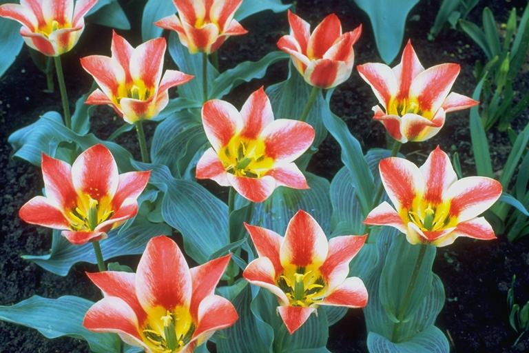
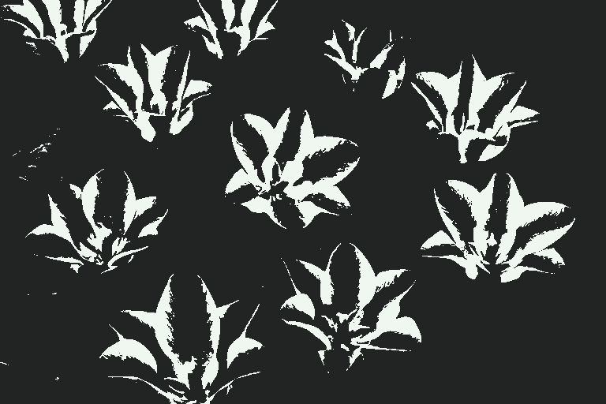
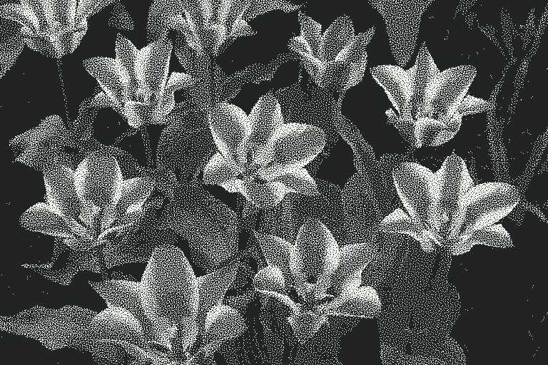
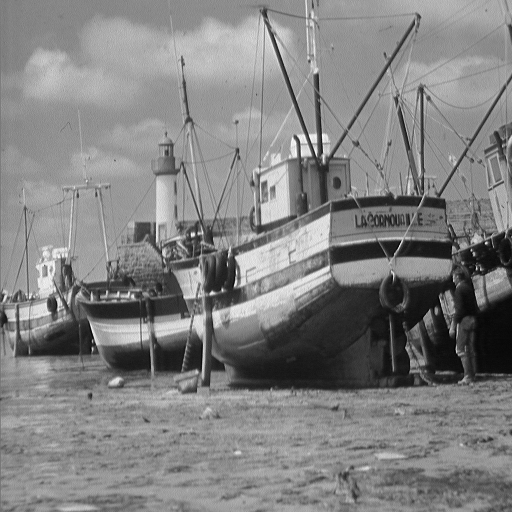
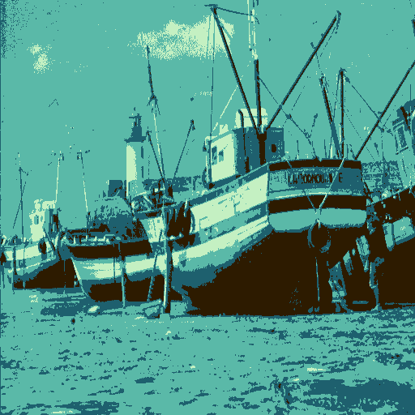
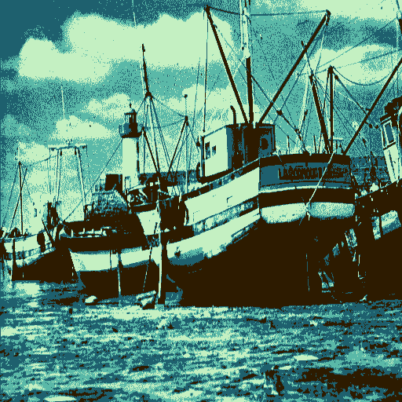

# Dither

A command line interface application that provides several image processing functions that can be applied to PNG images.

## Highlights

### Temporal Dithering for GIFs and Sprite Sheets
`-t` spreads each pixel across several frames of a gif, or of a vertical png sprite sheet, so that the frames average to colors the palette doesn't contain. The `PWM` method is deterministic, and each pixel starts at a different frame taken from a blue noise matrix, so every frame has about the same overall brightness. Below, the same two-color palette is used without and with temporal dithering:
| Input | `-r`, 2 colors | `-t PWM,8`, 2 colors over 8 frames |
| :-- | :-- | :-- |
|  |  |  |

`dither -i input/tulips.png -o output/tulips_temporal_pwm_1bit_monitor_glow.gif -t PWM,8,EUCLIDEAN_DISTANCE,1BIT_MONITOR_GLOW -a`</br>
See [Temporal Dithering](#temporal-dithering).

### Histogram Mapping onto the Palette
The `UNIFORM_HISTOGRAM` mapping method maps each pixel by its brightness rank in the image rather than by its color distance, so each palette color covers roughly the same share of the image. This recovers detail that nearest-color mapping loses when the palette doesn't match the tones of the image:
| Input | `EUCLIDEAN_DISTANCE` | `UNIFORM_HISTOGRAM` |
| :-- | :-- | :-- |
|  |  |  |

`dither -i input/boat.png -o output/boat_reduce_mist_gb_uniform_histogram.png -r UNIFORM_HISTOGRAM,MIST_GB`</br>
See [Palette Mapping Methods](#palette-mapping-methods).

## Install
Prebuilt binaries for Windows (x86-64), macOS (Apple Silicon and Intel) and Linux (x86-64 and arm64) are attached to each [release](https://github.com/johnconwell/dither/releases). Each archive contains the `dither` executable, this README, the license and the example csv files in `data/`. Extract it and add the folder to your `PATH`.

With [Homebrew](https://brew.sh/) (macOS and Linux):
```bash
brew install johnconwell/tap/dither
```

With [Scoop](https://scoop.sh/) (Windows):
```bash
scoop bucket add johnconwell https://github.com/johnconwell/scoop-bucket
scoop install dither
```

To build from source instead, see [To Compile](#to-compile).

## Quick Start
Run these from the root directory to use the sample images in `input/`, or point `-i` at any png image:
```bash
dither -i input/boat.png -o output/boat_ordered.png -d BLUE_NOISE_64X64,EUCLIDEAN_DISTANCE,TWILIGHT5
dither -i input/tulips.png -o output/tulips_error_diffusion.png -e FLOYD_STEINBERG,SERPENTINE,EUCLIDEAN_DISTANCE,SLSO8 -a
dither -i input/tulips.png -o output/tulips_temporal.gif -t PWM,8,EUCLIDEAN_DISTANCE,SLSO8 -a
```
The first dithers with a blue noise threshold matrix, the second with Floyd-Steinberg error diffusion in linear light, and the third makes an 8 frame temporally dithered gif.

## Usage
Use the `dither` command followed by the input and output flags and any number of optional flags. See the example section for a detailed look at use cases.</br>
Only one of `-r`, `-e`, `-d` and `-t` can be used per run. `-g` and `-c` can be combined with any of them. Operations always run in this order, whatever order the flags are given in: grayscale, convolve, then the reduce or dither operation.

## CLI
`dither [options]`
| Flag | Description | Necessity |
| :-- | :-- | :-- |
| `-h, --help` | Displays help | Optional |
| `-i, --input <FILE_PATH>` | Specifies the input png image file path | Required |
| `-o, --output <FILE_PATH>` | Specifies the file path the output png or gif will be saved to | Required |
| `-a, --gamma_correction` | Processes the image in linear light (gamma correction). Applies to `-g`, `-c`, `-r`, `-e`, `-d` and `-t`. See [Gamma Correction](#gamma-correction) | Optional |
| `-g, --grayscale <GRAYSCALE_WEIGHTS>` | Converts the input image to grayscale using the specified channel weights | Optional |
| `-c, --convolve <KERNEL>` | Convolves the input image using the specified kernel | Optional |
| `-r, --reduce <MAPPING_METHOD>,<PALETTE>` | Reduces the image to the specified palette without applying dithering | Optional |
| `-e, --error_diffusion <ALGORITHM>,<SCAN_PATTERN>,<MAPPING_METHOD>,<PALETTE>` | Dithers the image using the specified error diffusion algorithm and color mapping method | Optional |
| `-d, --ordered <THRESHOLD_MATRIX>,<MAPPING_METHOD>,<PALETTE>` | Dithers the image using the specified threshold matrix and color mapping method | Optional |
| `-t, --temporal <TEMPORAL_METHOD>,<TEMPORAL_FRAMES>,<MAPPING_METHOD>,<PALETTE>` | Dithers the image temporally using the specified temporal dithering method, color mapping method, and number of frames. Output can be saved to .gif or .png | Optional |
| `-b, --benchmark` | Displays the time taken to load, process and save the image to stdout. See [Benchmark](#benchmark) | Optional |

### Grayscale
Images can be converted to greyscale with the `-g, --grayscale` command.</br>
`dither -i INPUT_FILE_PATH -o OUTPUT_FILE_PATH -g GRAYSCALE_WEIGHTS`</br>
See [Grayscale Channel Weights](#grayscale-channel-weights) for available RGB channel weighting.

### Convolution
Images can be convolved with the `-c, --convolve` command</br>
`dither -i INPUT_FILE_PATH -o OUTPUT_FILE_PATH -c KERNEL`</br>
The input file must be .png. The output file may be .png or .gif.</br>
See [Convolution Kernels](#convolution-kernels) for available kernels.

### Reduce
Images can have their palette reduced with the `-r, --reduce` command</br>
`dither -i INPUT_FILE_PATH -o OUTPUT_FILE_PATH -r MAPPING_METHOD,PALETTE`</br>
The input file must be .png. The output file may be .png or .gif.</br>
See [Palette Mapping Methods](#palette-mapping-methods) for available color mapping methods from input image pixel colors to palette colors.</br>
See [Palettes](#palettes) for available palettes to map to.

### Error Diffusion Dithering
Images can be dithered using an error diffusion algorithm with the `-e, --error_diffusion` command</br>
`dither -i INPUT_FILE_PATH -o OUTPUT_FILE_PATH -e ALGORITHM,SCAN_PATTERN,MAPPING_METHOD,PALETTE`</br>
The input file must be .png. The output file may be .png or .gif.</br>
See [Error Diffusion Algorithms](#error-diffusion-algorithms) for available error diffusion algorithms (error kernels).</br>
See [Error Diffusion Scan Patterns](#error-diffusion-scan-patterns) for available scan patterns.</br>
See [Palette Mapping Methods](#palette-mapping-methods) for available color mapping methods from input image pixel colors to palette colors.</br>
See [Palettes](#palettes) for available palettes to map to.

### Ordered Dithering
Images can be dithered using a threshold matrix with the `-d, --ordered` command</br>
`dither -i INPUT_FILE_PATH -o OUTPUT_FILE_PATH -d THRESHOLD_MATRIX,MAPPING_METHOD,PALETTE`</br>
The input file must be .png. The output file may be .png or .gif.</br>
See [Ordered Threshold Matrixes](#ordered-threshold-matrixes) for available threshold matrixes.</br>
See [Palette Mapping Methods](#palette-mapping-methods) for available color mapping methods from input image pixel colors to palette colors.</br>
See [Palettes](#palettes) for available palettes to map to.

### Temporal Dithering
Images can be dithered in the time dimension with the `-t, --temporal` command</br>
`dither -i INPUT_FILE_PATH -o OUTPUT_FILE_PATH -t TEMPORAL_METHOD,TEMPORAL_FRAMES,MAPPING_METHOD,PALETTE`</br>
The input file must be .png. The output file may be .gif or .png.</br>
If the output file is a .gif, then the output will be a gif with `TEMPORAL_FRAMES` frames.</br>
If the output file is a .png, then the output will be a png with `TEMPORAL_FRAMES` frames arranged vertically.</br>
`TEMPORAL_FRAMES` must be a whole number from 1 to 256.</br>
See [Temporal Dithering Methods](#temporal-dithering-methods) for available temporal dithering methods.</br>
See [Palette Mapping Methods](#palette-mapping-methods) for available color mapping methods from input image pixel colors to palette colors.</br>
See [Palettes](#palettes) for available palettes to map to.

### Gamma Correction
Images can be processed in linear light with the `-a, --gamma_correction` flag</br>
`dither -i INPUT_FILE_PATH -o OUTPUT_FILE_PATH [OPTIONS...] -a`</br>
By default, every operation works directly on the sRGB encoded values stored in the png. With `-a`, the image is converted to linear light (values proportional to the physical brightness of each pixel), processed, and converted back to sRGB once at the end. This keeps the overall brightness of the image correct when colors are mixed: for example, a blur of black and white pixels averages to sRGB 188 rather than 128, and dithering sRGB 128 gray to black and white gives about 22% white pixels rather than 50%.</br>
The standard sRGB transfer function is used, unless the input png has a `gAMA` chunk and no `sRGB` chunk, in which case the file's gamma value is used.</br>
`-a` applies to `-g`, `-c`, `-r`, `-e`, `-d` and `-t`.

### Benchmark
Timing information can be displayed with the `-b, --benchmark` flag</br>
`dither -i INPUT_FILE_PATH -o OUTPUT_FILE_PATH [OPTIONS...] -b`</br>
After the output file has been saved, the time taken by each step is printed to stdout: `load`, each operation in the order it ran, `save`, then `processing` (the operations only) and `total`. Nothing is printed if the run fails.

### Grayscale Channel Weights
Options when using the `-g, --grayscale` flag. Each pixel in the input image will be converted to grayscale according to the weights specified by the option. In addition to the built-in grayscale weights below, the user can specify a csv file in the format:</br>
`R_CHANNEL_WEIGHT,G_CHANNEL_WEIGHT,B_CHANNEL_WEIGHT`</br>
The csv file must contain exactly one row of three values. Blank lines and Windows line endings are allowed. Each channel weight should be a floating point number between 0.0 and 1.0, and the three channel weights should sum to 1.0. Values outside this range or that sum to a different value are possible but may result in pixel luminosity clipping at the minimum and maximum values or the overall luminosity of the image changing. Examples are shown in the [grayscale_weights](data/grayscale_weights) folder.
| GRAYSCALE_WEIGHTS | Description |
| :-- | :-- |
| `STANDARD` | R: 0.3334<br/>G: 0.3333<br/>B: 0.3333 |
| `BT709` | R: 0.2126<br/>G: 0.7152<br/>B: 0.0722 |
| `CHANNEL_R` | R: 1.0<br/>G: 0.0<br/>B: 0.0 |
| `CHANNEL_G` | R: 0.0<br/>G: 1.0<br/>B: 0.0 |
| `CHANNEL_B` | R: 0.0<br/>G: 0.0<br/>B: 1.0 |
| `CHANNEL_RG` | R: 0.5<br/>G: 0.5<br/>B: 0.0 |
| `CHANNEL_RB` | R: 0.5<br/>G: 0.0<br/>B: 0.5 |
| `CHANNEL_GB` | R: 0.0<br/>G: 0.5<br/>B: 0.5 |

### Convolution Kernels
Options when using the `-c, --convolve` flag. The input image will be convolved against the kernel specified by the option. In addition to the built-in convolution kernels below, the user can specify a kernel of size (M x N) in a csv file in the format:</br>
`X11,X12,...,X1N`</br>
`X21,X22,...,X2N`</br>
`...,...,...,...`</br>
`XM1,XM2,...,XMN`</br>
Each element in the kernel must be a floating point number. Blank lines and Windows line endings are allowed. Examples are shown in the [convolution_kernels](data/convolution_kernels) folder.
| KERNEL | Description |
| :-- | :-- |
| `RIDGE_4` | { 0,-1, 0}<br/>{-1, 4,-1}<br/>{ 0,-1, 0} |
| `RIDGE_8` | {-1,-1,-1}<br/>{-1, 8,-1}<br/>{-1,-1,-1} |
| `SHARPEN_4` | { 0,-1, 0}<br/>{-1, 5,-1}<br/>{ 0,-1, 0} |
| `SHARPEN_8` | {-1,-1,-1}<br/>{-1, 9,-1}<br/>{-1,-1,-1} |
| `BOX_BLUR` | { 1, 1, 1}<br/>{ 1, 1, 1} * (1 / 9)<br/>{ 1, 1, 1} |
| `GAUSSIAN_BLUR` | 5x5 Gaussian function matrix, sigma = 1.0 |
| `UNSHARP_MASK` | { 0, 0, 0, 0, 0}<br/>{ 0, 0, 0, 0, 0}<br/>{ 0, 0, 2, 0, 0} - GAUSSIAN_BLUR <br/>{ 0, 0, 0, 0, 0}<br/>{ 0, 0, 0, 0, 0}<br/>

### Error Diffusion Algorithms
Algorithm options when using the `-e, --error_diffusion` flag. The input image will be quantized using the algorithm specified by the option. The 'X' in each kernel represents the pixel being quantized, and the rest of the kernel represents the fraction of error that will be diffused to the surrounding pixels. The bottom fraction in parentheses is a multiplier applied to each non-'X' member of the kernel.
| ALGORITHM | Description |
| :-- | :-- |
| `LINEAR` | {X, 1} |
| `FLOYD_STEINBERG` | {0, X, 7}<br/>{3, 5, 1}<br/>(1 / 16)|
| `JARVIS_JUDICE_NINKE` | {0, 0, X, 7, 5}<br/>{3, 5, 7, 5, 3}<br/>{1, 3, 5, 3, 1}<br/>(1 / 48)<br/>The old spelling `JARVICE_JUDICE_NINKE` is still accepted |
| `STUCKI` | {0, 0, X, 8, 4}<br/>{2, 4, 8, 4, 2}<br/>{1, 2, 4, 2, 1}<br/>(1 / 42) |
| `ATKINSON` | {0, X, 1, 1}<br/>{1, 1, 1, 0}<br/>{0, 1, 0, 0}<br/>(1 / 8) |
| `BURKES` | {0, 0, X, 8, 4}<br/>{2, 4, 8, 4, 2}<br/>(1 / 32) |
| `SIERRA` | {0, 0, X, 5, 3}<br/>{2, 4, 5, 4, 2}<br/>{0, 2, 3, 2, 0}<br/>(1 / 32) |
| `SIERRA_TWO_ROW` | {0, 0, X, 4, 3}<br/>{1, 2, 3, 2, 1}<br/>(1 / 16) |
| `SIERRA_LITE` | {0, X, 2}<br/>{1, 1, 0}<br/>(1 / 4) |

### Error Diffusion Scan Patterns
Scan Pattern options when using the `-e, --error_diffusion` flag. The scan pattern determines the order in which pixels are processed or quantized in the image.
| SCAN_PATTERN | Description |
| :-- | :-- |
| `RASTER` | Pixels will be quantized from left to right, starting at the top row and working down |
| `SERPENTINE` | Pixels will be quantized from left to right on even rows and right to left on odd rows, starting at the top row (row 0) and working down |

### Ordered Threshold Matrixes
Threshold matrix (or "map") options when using the `-d, --ordered` flag. The input image will be quantized against the threshold map specified by the option.<br/>
[Bayer](https://en.wikipedia.org/wiki/Ordered_dithering#Threshold_map) pattern threshold matrixes produce even results but leave noticable patterns in the output image. An NxN bayer matrix has N² distinct threshold levels, so an 8x8 matrix has 64 levels and a 16x16 matrix has all 256 levels of an 8-bit channel. Bayer matrixes larger than 16x16 cannot add more levels, and 8x8 is usually enough when the palette has more than a few colors.<br/>
[Blue Noise](https://github.com/johnconwell/noise2d) threshold matrixes contain only high-frequency noise, producing even results with few noticeable patterns, especially when using larger threshold matrixes.<br/>
[White Noise](https://en.wikipedia.org/wiki/White_noise) threshold matrixes produce uneven results and leave noticable patterns in the output image. They are included for comparison.</br>
In addition to the built-in threshold matrixes below, the user can specify a threshold matrix of size (M x N) in a csv file in the format:</br>
`X11,X12,...,X1N`</br>
`X21,X22,...,X2N`</br>
`...,...,...,...`</br>
`XM1,XM2,...,XMN`</br>
Each element in the threshold matrix must be a whole number with a value between 0 and 255, inclusive. Blank lines and Windows line endings are allowed. Examples are shown in the [threshold_matrixes](data/threshold_matrixes) folder.
| THRESHOLD_MATRIX | Description |
| :-- | :-- |
| `BAYER_2X2` | 2x2 Bayer pattern threshold matrix |
| `BAYER_4X4` | 4x4 Bayer pattern threshold matrix |
| `BAYER_8X8` | 8x8 Bayer pattern threshold matrix |
| `BAYER_16X16` | 16x16 Bayer pattern threshold matrix |
| `BLUE_NOISE_2X2` | 2x2 blue noise threshold matrix |
| `BLUE_NOISE_4X4` | 4x4 blue noise threshold matrix |
| `BLUE_NOISE_8X8` | 8x8 blue noise threshold matrix |
| `BLUE_NOISE_16X16` | 16x16 blue noise threshold matrix |
| `BLUE_NOISE_32X32` | 32x32 blue noise threshold matrix |
| `BLUE_NOISE_64X64` | 64x64 blue noise threshold matrix |
| `BLUE_NOISE_128X128` | 128x128 blue noise threshold matrix |
| `BLUE_NOISE_256X256` | 256x256 blue noise threshold matrix |
| `WHITE_NOISE_2X2` | 2x2 white noise threshold matrix |
| `WHITE_NOISE_4X4` | 4x4 white noise threshold matrix |
| `WHITE_NOISE_8X8` | 8x8 white noise threshold matrix |
| `WHITE_NOISE_16X16` | 16x16 white noise threshold matrix |
| `WHITE_NOISE_32X32` | 32x32 white noise threshold matrix |
| `WHITE_NOISE_64X64` | 64x64 white noise threshold matrix |
| `WHITE_NOISE_128X128` | 128x128 white noise threshold matrix |
| `WHITE_NOISE_256X256` | 256x256 white noise threshold matrix |

### Temporal Dithering Methods
Temporal method options when using the `-t, --temporal` flag. Each pixel in the input image will be assigned a palette color in each output frame according to the method specified by the option, so that the frames average to the original color when viewed in quick succession.
| TEMPORAL_METHOD | Description |
| :-- | :-- |
| `PWM` | Modulates each pixel between the nearest lighter and darker palette colors (by lightness). The pixel shows the lighter color in exactly round(duty cycle × frames) consecutive frames, where the duty cycle comes from the pixel's distance to the two colors. Each pixel starts at a different frame, taken from a blue noise matrix, so every frame has about the same overall brightness |
| `STOCHASTIC_PWM` | Like `PWM`, but each frame independently picks the lighter color with probability equal to the duty cycle. This was the `PWM` behaviour before v2.0.0; it flickers more |
| `RANDOM` | Randomly assigns each pixel of each frame to any palette color, weighted by the inverse of the color distance (1 / distance). A pixel that exactly matches a palette color always uses that color |

### Palette Mapping Methods
Mapping method options when using the `-r, --reduce`, `-e, --error_diffusion`, `-d, --ordered`, or `-t, --temporal` flags. Each pixel in the output image will be mapped to a color in the palette according to the specified option. Pixels are mapped after accumulated error is applied in error diffusion algorithms and after the threshold matrix is applied in ordered algorithms. When `-a` is used, distances are measured in linear light.
| MAPPING_METHOD | Description |
| :-- | :-- |
| `EUCLIDEAN_DISTANCE` | Maps each pixel to the nearest palette color by Euclidean distance, with each channel weighted by its BT.709 luminance coefficient (R: 0.2126, G: 0.7152, B: 0.0722) |
| `MANHATTAN_DISTANCE` | Maps each pixel to the palette color with the smallest sum of absolute differences across the R, G and B channels (L1 distance). The channels are not weighted |
| `UNIFORM_HISTOGRAM` | Histogram equalisation onto the palette: the palette is sorted darkest to lightest, and each pixel is mapped by its luminance rank in the image, so the output contains approximately equal amounts of each palette color. Error diffusion and ordered dithering work on the same rank scale. Hue does not affect which color is chosen. An image with a single luminance falls back to `EUCLIDEAN_DISTANCE`. Not valid when using `-t` flag. |

### Palettes
Palette options when using the `-r, --reduce`, `-e, --error_diffusion`, `-d, --ordered`, or `-t, --temporal` flags. The following palettes are built in and can be referenced by name. In addition to the built-in palettes below, the user can specify a palette in a csv file in the format:</br>
`NAME,AUTHOR,COLOR1,COLOR2,...`</br>
where `COLORX` is a hexadecimal color code. This format exactly matches the Lospec API, so any Lospec palette csv can be downloaded by appending ".csv" to the URL of a lospec palette. See examples in the [palettes](./data/palettes/) folder.
| PALETTE | Description |
| :-- | :-- |
| 1BIT_MONITOR_GLOW | [lospec](https://lospec.com/palette-list/1bit-monitor-glow) |
| NOIRE_TRUTH | [lospec](https://lospec.com/palette-list/noire-truth) |
| TITANSTONE | [lospec](https://lospec.com/palette-list/titanstone) |
| ICE_CREAM_GB | [lospec](https://lospec.com/palette-list/ice-cream-gb) |
| MIST_GB | [lospec](https://lospec.com/palette-list/mist-gb) |
| CRIMSON | [lospec](https://lospec.com/palette-list/crimson) |
| FIERY_PLAGUE_GB | [lospec](https://lospec.com/palette-list/fiery-plague-gb) |
| TWILIGHT5 | [lospec](https://lospec.com/palette-list/twilight-5) |
| OIL6 | [lospec](https://lospec.com/palette-list/oil-6) |
| MIDNIGHT_ABLAZE | [lospec](https://lospec.com/palette-list/midnight-ablaze) |
| SLSO8 | [lospec](https://lospec.com/palette-list/slso8) |

## Examples
The below examples are executed from the root directory and assume `dither` is on your path. Otherwise, use `./bin/dither` (or `.\bin\dither.exe` in the Windows Command Prompt). Forward slashes work in file paths on every platform. Input and output directories are shown relative to the root directory, but absolute paths can be used as well.</br>
`dither -i input/baboon.png -o output/baboon_grayscale_bt709.png -g BT709`</br>
`dither -i input/boat.png -o output/boat_reduce_twilight5.png -r MANHATTAN_DISTANCE,TWILIGHT5`</br>
`dither -i input/lena.png -o output/lena_convolve_unsharp_mask.png -c UNSHARP_MASK`</br>
`dither -i input/earth.png -o output/earth_error_diffusion_jarvis-judice-ninke_raster_twilight5.png -e JARVIS_JUDICE_NINKE,RASTER,EUCLIDEAN_DISTANCE,TWILIGHT5`</br>
`dither -i input/lena.png -o output/lena_error_diffusion_atkinson_serpentine_midnight_ablaze.png -e ATKINSON,SERPENTINE,EUCLIDEAN_DISTANCE,MIDNIGHT_ABLAZE -a`</br>
`dither -i input/peppers.png -o output/peppers_ordered_blue_noise_64x64_cherrymelon.png -d BLUE_NOISE_64X64,EUCLIDEAN_DISTANCE,data/palettes/cherrymelon.csv`</br>
`dither -i input/baboon.png -o output/baboon_ordered_bayer_16x16_witching-hour.png -d BAYER_16X16,EUCLIDEAN_DISTANCE,data/palettes/witching-hour.csv -a`</br>
`dither -i input/tulips.png -o output/tulips_temporal_pwm_slso8.gif -t PWM,8,EUCLIDEAN_DISTANCE,SLSO8 -a`</br>
`dither -i input/tulips.png -o output/tulips_temporal_pwm_noire_truth.png -t PWM,4,EUCLIDEAN_DISTANCE,NOIRE_TRUTH -a`</br>

## To Compile
Requirements: GNU C++ compiler (GCC 13 or newer), make<br/>
Open a terminal in the root directory and enter the command
```bash
> make
```
On macOS, install GCC with Homebrew (`brew install gcc`) and pass it to make, for example `make CC=g++-15` (use the version number Homebrew installed), since Apple clang's standard library may not support everything Dither uses.<br/>
Extra linker flags can be passed with `LDFLAGS`. For example, `make LDFLAGS=-static` builds an executable that doesn't need the compiler's runtime libraries, which is how the release binaries are built on Windows and Linux (macOS uses `-static-libgcc -static-libstdc++`).

## Testing
Open a terminal in the root directory and enter the command
```bash
> make test
```
This builds `dither` and the test runner, then runs every test and reports the number of passes and failures. Tests generate their images at run time in `tests/tmp/`, which `make clean` removes.</br>
Tests are defined in [tests/test_main.cpp](tests/test_main.cpp). A test marked `TEST` must pass. A test marked `XFAIL` is a known bug that is expected to fail; if it starts passing, the runner reports `XPASS` and the run fails until `XFAIL` is changed to `TEST`.</br>
The test runner can also be run directly. Add `-v` to show the details of expected failures, or the names of tests to run only those tests:</br>
`./bin/test_dither ./bin/dither -v`</br>
`./bin/test_dither ./bin/dither convolve_identity ed_kernel_sums`

## Releases
[.github/workflows/build.yml](.github/workflows/build.yml) builds and tests Dither on Windows, macOS and Linux for every push and pull request. Pushing a tag named after the version, for example `v2.1.0`, also creates a GitHub release containing:
- an archive for each platform, made by [scripts/package.sh](scripts/package.sh)
- `SHA256SUMS`
- `dither.rb`, a Homebrew formula, and `dither.json`, a Scoop manifest, filled in from the templates in [packaging](packaging) by [scripts/render_packaging.sh](scripts/render_packaging.sh)

The release notes are taken from this README's changelog section for that version. Tags containing a `-`, such as `v2.1.0-rc1`, are marked as prereleases.</br>
If the repository has a `PACKAGING_TOKEN` secret (a token that can push to [johnconwell/homebrew-tap](https://github.com/johnconwell/homebrew-tap) and [johnconwell/scoop-bucket](https://github.com/johnconwell/scoop-bucket)), the formula and manifest are also committed to `Formula/dither.rb` and `bucket/dither.json` in those repositories for every release that is not a prerelease. Without the secret, copy them there by hand.

## Why Use Dither Instead of ImageMagick?
[ImageMagick](https://imagemagick.org/) is a mature and powerful tool with far more features than Dither. Most of the time, you probably should use ImageMagick. However, Dither has a few features that ImageMagick does not:
- Temporal dithering, which spreads each pixel across several frames of a gif or a vertical png sprite sheet
- A histogram equalisation mapping method that uses approximately equal amounts of each palette color
- Built-in blue noise threshold matrixes for ordered dithering, plus the ability to specify a threshold matrix as a csv
- Nine built-in error diffusion algorithms (ImageMagick has two built-in algorithms)
- Several built-in palettes, plus the ability to specify a palette through a csv file (obtained directly from Lospec) rather than another image

ImageMagick can also convert to grayscale with arbitrary channel weights (`-color-matrix`) and convolve with custom kernels (`-morphology Convolve`). Dither's built-in presets and csv files for these are a convenience rather than a missing feature.


## Libraries
[Noise2D](https://github.com/johnconwell/noise2d) - used to generate threshold matrixes for ordered dithering</br>
[LodePNG](https://lodev.org/lodepng/) - provides png encoding/decoding functions</br>
[gif-h](https://github.com/charlietangora/gif-h) - provides gif writing functions

## Changelog

### Unreleased
- Prebuilt binaries for Windows, macOS and Linux are attached to each GitHub release, along with a Homebrew formula and a Scoop manifest. See [Install](#install) and [Releases](#releases).
- `make` accepts extra linker flags through `LDFLAGS`, for example `make LDFLAGS=-static`.
- README: added highlights, install and quick start sections, made the examples platform-neutral, and clarified which features ImageMagick also has.

### 2.0.0
Breaking changes:
- Only one of `-r`, `-e`, `-d` and `-t` can be used per run; combining them is now an error. `-g` and `-c` can still be combined with any of them.
- `UNIFORM_HISTOGRAM` now performs histogram equalisation, so each palette color covers roughly the same share of the image. Output differs from earlier versions.
- `PWM` temporal dithering is now deterministic: each pixel shows the lighter color in a fixed number of frames, which reduces flicker and gives the same output on every run. The previous random behavior is available as `STOCHASTIC_PWM`.
- `-a` now also applies to `-c`, so convolution can run in linear light.

Other changes:
- Added the correct spelling `JARVIS_JUDICE_NINKE`. `JARVICE_JUDICE_NINKE` is still accepted.
- README: corrected the `-e` and `-t` syntax and the `--error_diffusion` spelling, and added sections on gamma correction, benchmark output, testing, CSV formats and the minimum GCC version.

### 1.2.0
- Faster startup and a smaller executable.
- Invalid options are reported before the input image is loaded. Every error is printed as `Error: <message>` and exits with code 1. CSV errors name the file and line.
- CSV files may contain blank lines and Windows line endings. Values that are not valid numbers are rejected, threshold matrix values must be whole numbers from 0 to 255, and grayscale weights must be a single row of three values.
- `-b` now reports the time taken to load, run each operation, save, and in total. It is printed only after the output has been saved successfully.

### 1.1.0
- Convolution no longer shifts the image or leaves black borders; edge pixels are extended instead. Results are rounded rather than truncated.
- Convolution kernels are now flipped (true convolution), so asymmetric custom kernels such as `emboss.csv` give mirrored results compared with 1.0.x.
- `-a` now gives correct results. Dithered output is no longer far too dark, the standard sRGB curve is used, and grayscale conversion keeps every gray level.
- Error diffusion keeps small errors instead of discarding them, reducing banding with palettes of similar colors.
- Ordered dithering no longer darkens the image, most noticeably with `BAYER_2X2` and the small white noise matrixes.
- Transparency is kept. Fully transparent pixels are left unchanged and don't affect their neighbors.
- Error diffusion is about three times faster.

### 1.0.1
- Fixed ordered dithering forcing about half of all pixels to the darkest palette color.
- Fixed `WHITE_NOISE_64X64` not being recognized.
- Fixed `UNIFORM_HISTOGRAM` scaling all channels by the red channel, failing on some images, and mapping single-color images to the darkest palette color.
- Invalid input now gives a clear error and a non-zero exit code instead of crashing or silently writing nothing. This covers invalid frame counts (must be 1 to 256), unknown scan patterns, temporal methods and mapping methods, `UNIFORM_HISTOGRAM` with `-t`, empty palette files, threshold values outside 0 to 255, unsupported output file types and failed gif writes.
- The output format is decided by the file extension (`.png` or `.gif`, case-insensitive).
- `RANDOM` temporal dithering handles pixels that exactly match a palette color.
- Fixed typos in the `-a` and `-g` help text.
- Builds with GCC 13 or newer. `make clean` no longer deletes the `output/` folder, and `make test` runs the new test suite.
